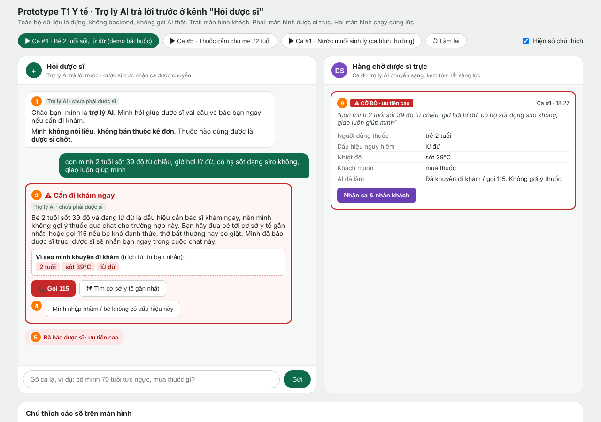
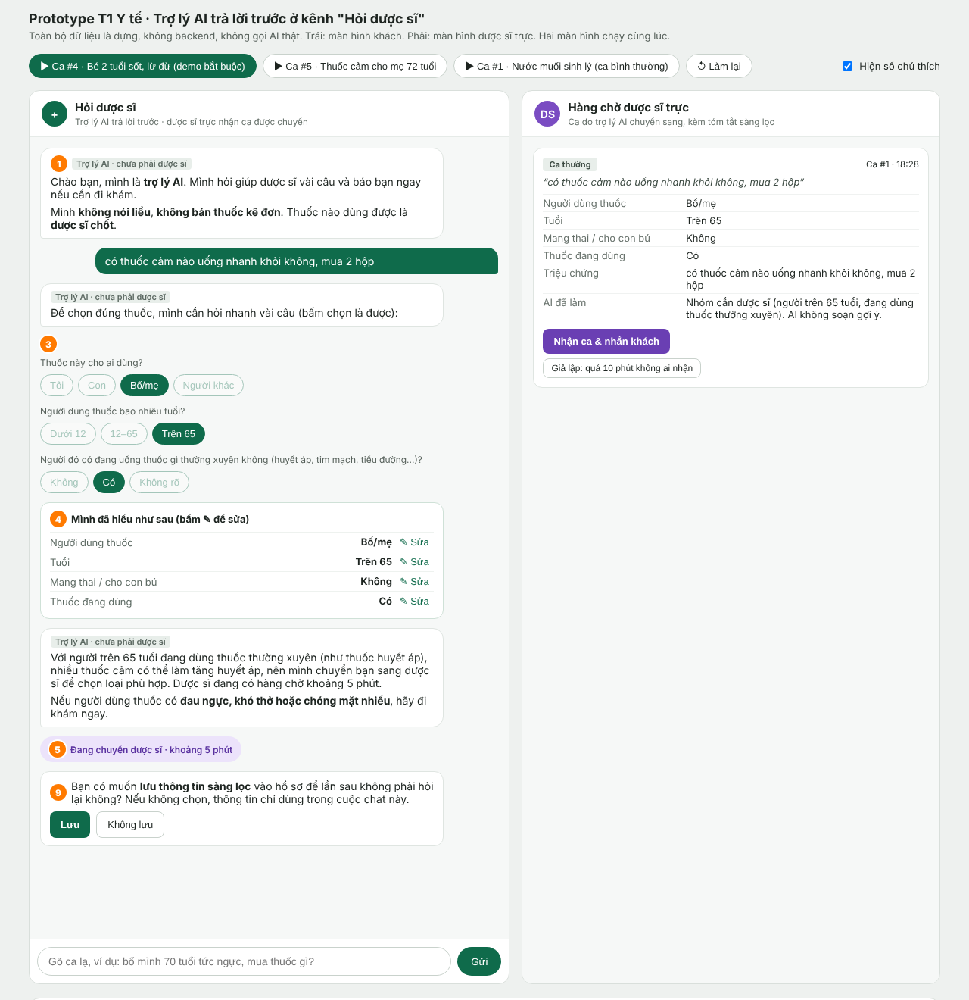
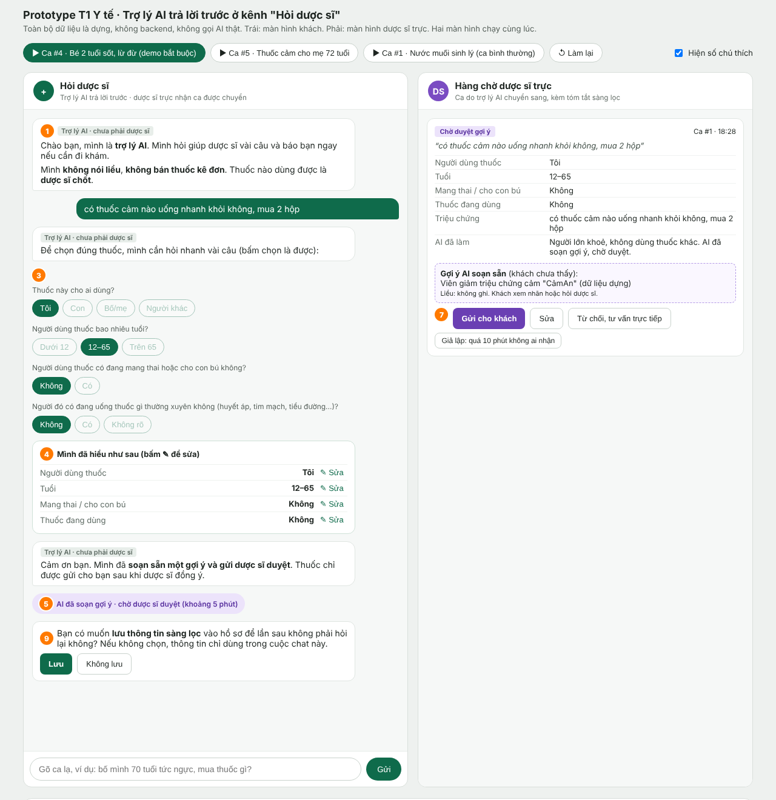

# Prototype · T1 Y tế

- **File:** `index.html`. Tải về rồi mở bằng trình duyệt. Không cần cài gì, không backend, không gọi AI thật.
- **Hai màn hình chạy cạnh nhau:** trái là khách chat, phải là hàng chờ dược sĩ trực.
- **Ca chạy sẵn (nút trên cùng):**
  - Ca #4 · Bé 2 tuổi sốt, lừ đừ (demo bắt buộc)
  - Ca #5 · Thuốc cảm cho mẹ 72 tuổi
  - Ca #1 · Nước muối sinh lý
- **Ca lạ:** gõ vào ô chat của khách.
- Bật hoặc tắt "Hiện số chú thích" để xem các số ①–⑩. Bảng giải thích từng số nằm cuối trang và trong `spec.md` §5.

## Ảnh có đánh số

1. `anh-1-ca4-khan-cap.png`: ca #4, thẻ đỏ khuyên đi khám, báo dược sĩ ưu tiên cao (①②④⑤⑥)
2. `anh-2-ca5-sang-loc.png`: ca #5, sàng lọc bằng nút bấm, chuyển dược sĩ, hỏi đồng ý lưu (①③④⑤⑨)
3. `anh-3-duoc-si-duyet.png`: người lớn khoẻ, AI soạn gợi ý, dược sĩ duyệt mới gửi (③④⑤⑦⑨)

